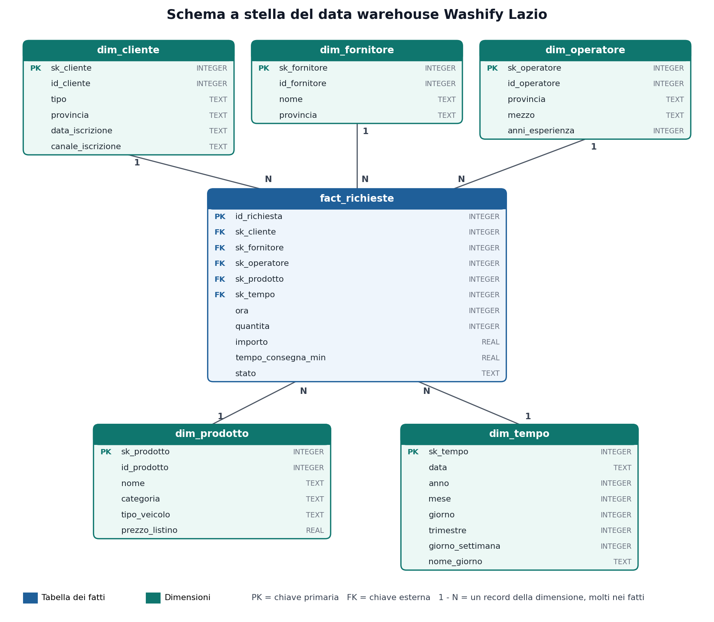
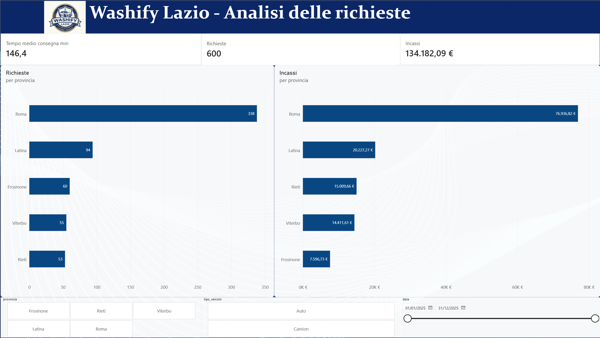
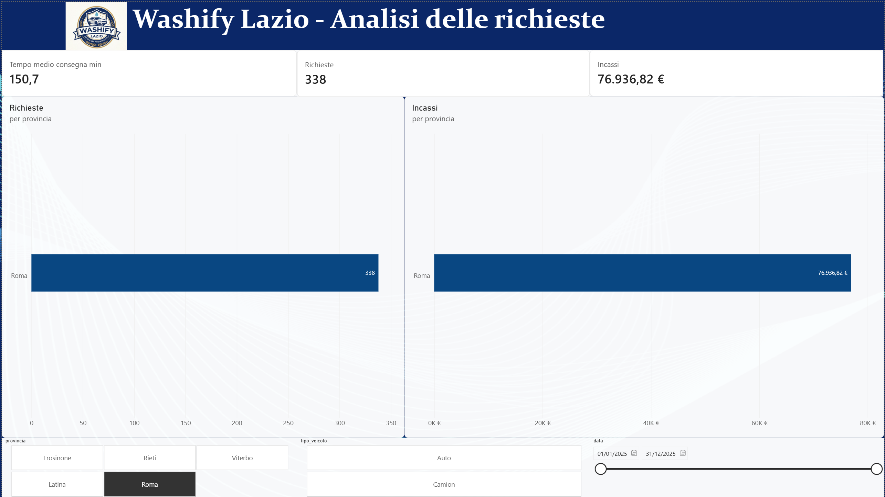
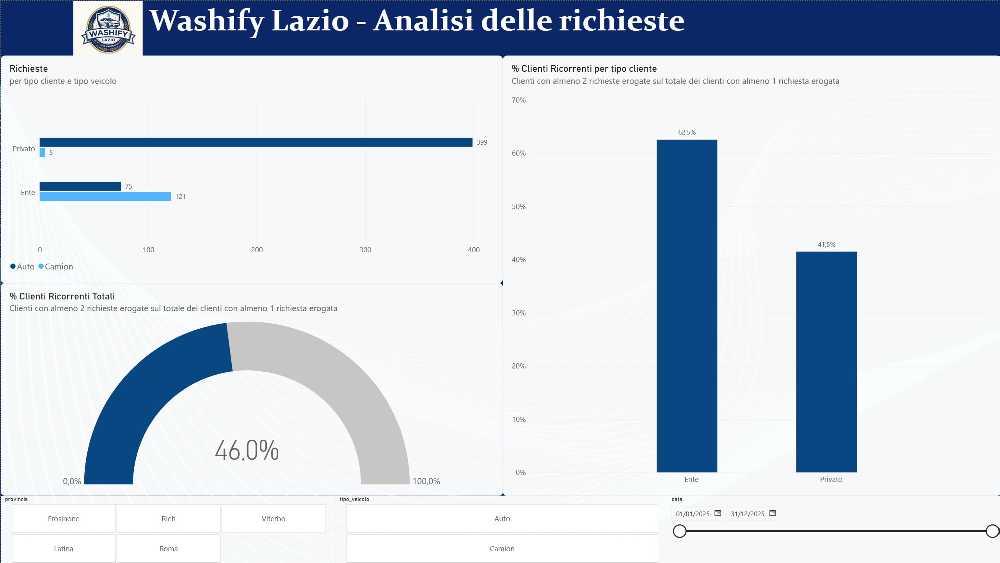

# Washify Lazio · Data warehouse e dashboard per una startup di servizi on-demand

Project Work, traccia **PW 21**: *Progettare l'analisi dei dati per una startup digitale di servizi on-demand*
(Tema 1 – La digitalizzazione dell'impresa · Corso di laurea L-31, Informatica per le aziende digitali).

**Washify Lazio** è una startup **fittizia** che, tramite app, fornisce prodotti per il lavaggio e la cura di auto e
camion a clienti privati ed enti (autolavaggi, officine, flotte aziendali) nelle cinque province del Lazio.
I prodotti arrivano da fornitori partner (grossisti) e vengono consegnati da operatori.

Il prototipo raccoglie i dati sparsi di clienti, fornitori, operatori e ordini in un unico archivio organizzato
**a stella**, li pulisce con una procedura ETL (Estrazione, Trasformazione, Caricamento) e li presenta in una
**dashboard Power BI** con indicatori, grafici e filtri.

## Flusso dei dati

```
genera_dati.py        etl.py                          Power BI
CSV grezzi  ──►  pulizia + schema a stella  ──►  CSV puliti  ──►  dashboard
(data/raw)       database SQLite                 (data/export)
                 (data/warehouse)
                        │
                  verifica.py (query SQL di controllo e indicatori)
```

## Requisiti

- Python 3.10 o successivo
- Libreria `pandas` (il modulo `sqlite3` fa già parte di Python): `pip install -r requirements.txt`
- Power BI Desktop (gratuito, solo Windows) per aprire la dashboard

## Avvio rapido

Dalla cartella del progetto:

```bash
python -m venv .venv
.venv\Scripts\activate            # Windows (PowerShell)
pip install -r requirements.txt

python genera_dati.py             # 1. crea i CSV con i dati inventati in data/raw/
python etl.py                     # 2. pulisce i dati, crea il database e i CSV puliti
python verifica.py                # 3. query SQL di controllo e indicatori
```

Poi apri `dashboard/Washify_Lazio.pbix` con Power BI Desktop.

Se PowerShell blocca l'attivazione dell'ambiente ("esecuzione di script disabilitata"), esegui una volta
`Set-ExecutionPolicy -Scope CurrentUser RemoteSigned`.

Gli script si possono rilanciare più volte: ogni esecuzione ricrea i dati e il database da zero.

## Parametri di riproducibilità

Con gli stessi parametri si ottengono esattamente gli stessi dati (generatore pseudo-casuale con seme fisso).
I parametri si trovano in cima a `genera_dati.py`.

| Parametro | Valore | Costante |
|---|---|---|
| Seme casuale | 42 | `SEED` |
| Clienti / fornitori / operatori | 500 / 300 / 300 | `N_CLIENTI`, `N_FORNITORI`, `N_OPERATORI` |
| Prodotti | 36 (6 categorie × auto/camion × 3 varianti) | – |
| Richieste valide | 600 | `N_RICHIESTE` |
| Periodo delle richieste | 01/01/2025 – 31/12/2025 | `INIZIO_RICHIESTE`, `FINE_RICHIESTE` |
| Difetti voluti nei dati | attivi, circa il 3% delle righe | `DIFETTI`, `QUOTA_DIFETTI` |

Il periodo del calendario (`dim_tempo`) è definito in `etl.py` (`INIZIO_CALENDARIO`, `FINE_CALENDARIO`) e deve
coprire tutte le date delle richieste.

## Struttura del progetto

```
├── genera_dati.py        generatore dei dati inventati (CSV)
├── etl.py                pulizia, schema a stella, caricamento ed esportazione
├── verifica.py           query SQL di controllo e degli indicatori
├── requirements.txt      librerie necessarie
├── data/
│   ├── raw/              CSV grezzi (clienti, fornitori, operatori, prodotti, richieste)
│   ├── warehouse/        database SQLite Washify_Lazio.db
│   └── export/           CSV puliti, uno per tabella, letti da Power BI
├── dashboard/            Washify_Lazio.pbix
└── docs/
    └── Screenshot/       schema a stella e screenshot della dashboard
```

## Modello dei dati

Schema a stella con una tabella dei fatti e cinque dimensioni.



- **`fact_richieste`**: una riga per ogni ordine. Misure: `quantita`, `importo`, `tempo_consegna_min`; attributi
  `stato` (`completata`, `in_ritardo`, `annullata`) e `ora`. Contiene le chiavi esterne verso le dimensioni.
- **`dim_cliente`**: tipo (Privato/Ente), provincia, data e canale di iscrizione.
- **`dim_fornitore`**: nome e provincia.
- **`dim_operatore`**: provincia, mezzo di consegna e anni di esperienza.
- **`dim_prodotto`**: nome, categoria, tipo di veicolo (Auto/Camion) e prezzo di listino.
- **`dim_tempo`**: calendario giornaliero con anno, mese, giorno, trimestre, giorno della settimana e nome del giorno.

Ogni dimensione ha una **chiave surrogata** (`sk_*`, chiave primaria) distinta dal codice di origine (`id_*`).
Le chiavi esterne della tabella dei fatti puntano alle chiavi surrogate. `sk_tempo` è la data scritta come numero
(`AAAAMMGG`), per collegare ogni richiesta al proprio giorno senza una ricerca.

**Zona di analisi**: la provincia del cliente, cioè il luogo in cui il prodotto viene consegnato.

## Cosa fa l'ETL

1. **Extract**: legge i CSV da `data/raw/`.
2. **Transform**: pulisce i dati (tabella sotto) e sostituisce i codici di origine con le chiavi surrogate.
3. **Load**: ricrea le tabelle con chiavi primarie ed esterne e le riempie. Esporta anche i CSV puliti in
   `data/export/`.

| Problema nei dati di origine | Trattamento |
|---|---|
| Province scritte con maiuscole e spazi diversi (`ROMA`, ` Roma `) | spazi tolti e iniziale maiuscola |
| Righe duplicate nelle richieste (18 nei dati di default) | rimosse in base a `id_richiesta` |
| Stato scritto in modi diversi (`COMPLETATA`, ` completata`) | normalizzato in minuscolo e senza spazi |
| Importi con la virgola decimale (`"89,5"`) | convertiti in numero |
| Date in due formati (`2025-03-14 10:30` e `14/03/2025 10:30`) | entrambi riconosciuti |
| Importo e tempo vuoti nelle richieste annullate | mantenuti: sono dati validi |

Le richieste annullate non hanno importo né tempo di consegna: non vanno eliminate, perché servono al calcolo del
tasso di annullamento.

## Indicatori

| Indicatore | Definizione |
|---|---|
| Richieste | numero di richieste valide, comprese le annullate |
| Incassi | somma degli importi delle richieste erogate (completate o in ritardo) |
| Tempo medio di consegna | media dei minuti tra ordine e consegna, sulle richieste erogate |
| Clienti ricorrenti (%) | clienti con almeno 2 richieste erogate ÷ clienti con almeno 1 richiesta erogata |

Gli indicatori sono calcolati sia in SQL (`verifica.py`) sia con misure DAX in Power BI, e danno gli stessi risultati.
Con i parametri di default:

| Indicatore | Valore atteso |
|---|---|
| Richieste | 600 (488 completate, 69 in ritardo, 43 annullate) |
| Incassi | 134.182,09 € |
| Tempo medio di consegna | 146,4 minuti |
| Clienti ricorrenti | 46,0% (120 su 261 clienti attivi) |

## Controlli di verifica

`verifica.py` apre il database e stampa:

- il numero di righe di ogni tabella (500, 300, 300, 36, 365, 600)
- l'esito del controllo delle chiavi esterne (`PRAGMA foreign_key_check`), che deve risultare vuoto
- le richieste per stato, gli incassi e il tempo medio
- le richieste per provincia, per tipo di cliente e di veicolo, per ora e per giorno della settimana
- la percentuale di clienti ricorrenti

## Dashboard

Il file `dashboard/Washify_Lazio.pbix` contiene tre pagine, con tre filtri (provincia, tipo di veicolo e periodo)
sincronizzati su tutte:

1. **Panoramica**: richieste, incassi e tempo medio, e richieste e incassi per provincia.
2. **Andamento nel tempo**: richieste per mese, per ora e per giorno della settimana.
3. **Clienti e prodotti**: richieste per tipo di cliente e di veicolo, percentuale di clienti ricorrenti totale e
   per tipo di cliente.



Con un filtro attivo (qui la provincia di Roma) tutti gli indicatori e i grafici si aggiornano: 338 richieste,
76.936,82 € di incassi e 150,7 minuti di tempo medio di consegna.





Le misure sono scritte in DAX: `Richieste` (conteggio delle righe dei fatti), `Incassi` (somma di `importo`),
`Tempo medio consegna` (media di `tempo_consegna_min`) e `% Clienti Ricorrenti`.

### Se sposti il progetto

Power BI legge i CSV di `data/export/` e ricorda il percorso del computer su cui è stato creato. Su un altro
computer, dopo aver eseguito gli script:

1. In Power BI Desktop: **Home → Trasforma dati → Impostazioni origine dati → Cambia origine**.
2. Seleziona il nuovo percorso della cartella `data/export/` per ciascuna delle sei tabelle.
3. **Chiudi e applica**.

I CSV usano il punto come separatore decimale: nella query `fact_richieste` (e in `dim_prodotto`) le colonne
decimali sono impostate con le impostazioni locali **Inglese (Stati Uniti)**, altrimenti Power BI in italiano
leggerebbe i numeri in modo sbagliato.

## Privacy

Tutti i dati sono generati dal programma. I clienti sono identificati solo da un codice, una provincia, una data di
iscrizione e un canale di iscrizione: non esistono nomi, indirizzi, telefoni o email. I nomi dei fornitori sono
combinazioni casuali di parole.

## Limiti e possibili miglioramenti

- Ogni ordine contiene **un solo prodotto**: per analizzare ordini con più articoli servirebbe una tabella di
  dettaglio ordine.
- **Nessuno storico delle anagrafiche**: se un cliente cambia provincia, la modifica sovrascrive il dato.
  Si potrebbe conservare la versione precedente di ogni anagrafica (*Slowly Changing Dimensions*).
- **Caricamento completo a ogni esecuzione**: non c'è un caricamento incrementale dei nuovi dati.
- **Pochi controlli sulla qualità dei dati** (conteggi e chiavi esterne): si potrebbero aggiungere regole con soglie
  e un registro dei caricamenti.
- Il calendario copre un periodo fisso (il 2025).
- I dati sono inventati: con dati reali andrebbero riviste le regole di pulizia.
- Power BI Desktop funziona solo su Windows, e legge i CSV esportati dall'ETL invece di collegarsi direttamente
  al database SQLite.

## Strumenti e supporto

Python, `pandas`, SQLite, Power BI Desktop e Visual Studio Code. Il logo della dashboard è stato generato con
Gemini.
